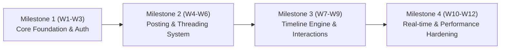

# Product Requirements Document (PRD)
# Text-Based Social Media Platform ("Threads" Alternative)

- **Document Version:** 1.0.0
- **Status:** Draft / Ready for Review
- **Author:** Gary Hardyansyah & Antigravity
- **Target Audience:** General

---

## 1. Executive Summary & Vision

### 1.1 Visi Produk
Membangun platform media sosial berbasis teks (*text-first*) yang cepat, elegan, dan minim distraksi, terinspirasi oleh pengalaman interaksi percakapan dinamis seperti pada platform **Meta Threads** dan **X (Twitter)**. Platform ini dirancang untuk memfasilitasi percakapan mendalam, diskusi komunitas, pertukaran ide, serta interaksi real-time dengan latensi ultra-rendah dan *user experience* yang sangat mulus.

### 1.2 Nilai Utama (Core Values)
1. **Performance-First:** Rendering UI 60 FPS, waktu muat awal (*First Contentful Paint*) < 1.0 detik, dan latensi pemuatan feed p95 < 100ms.
2. **Conversation-Driven:** Desain hierarki percakapan berantai (*nested thread trees*) yang intuitif dan mudah dipahami.
3. **Reliability & Scalability:** Dibangun dengan arsitektur *Clean Architecture* pada Golang Microservices yang modular, resilient, dan mampu menangani throughput tinggi (*high read-to-write ratio*).
4. **Modern Developer Experience & Consistency:** Menggunakan React + TypeScript + Tailwind CSS + shadcn/ui di sisi frontend, serta PostgreSQL dengan manajemen skema terpadu.

---

## 2. Product Goals & Scope

### 2.1 Goals (Tujuan Utama)
- Menyediakan platform publikasi teks hingga 500 karakter per postingan dengan dukungan lampiran multimedia (gambar).
- Menyediakan sistem umpan (*feed*) ganda: **"Following"** (kronologis terbalik) dan **"For You"** (rekomendasi berbasis keterlibatan).
- Menghadirkan sistem percakapan berantai (*threading system*) yang responsif dengan *optimistic UI updates*.
- Mendukung interaksi *real-time* (notifikasi instan dan pembaruan counter suka/balasan melalui WebSocket/SSE).
- Arsitektur backend berbasis Golang microservices yang *decoupled*, *testable*, dan mengadopsi prinsip *Clean Architecture* (*Domain-Driven Design* ringan).

### 2.2 Non-Goals (Di Luar Cakupan MVP)
- Fitur live streaming video atau audio spaces (akan dipertimbangkan di v2).
- Sistem Direct Messaging (DM) end-to-end encrypted (fokus MVP adalah interaksi ruang publik/threads).
- Monetisasi, iklan bertarget, atau sistem langganan berbayar.
- Federasi ActivityPub / Fediverse integration (direncanakan untuk evaluasi di fase lanjutan).

---

## 3. User Personas & Core User Journeys

### 3.1 User Personas
1. **The Thought Sharer (Konten Kreator Teks):** Penulis, developer, jurnalis, atau pemerhati tren yang ingin membagikan pemikiran singkat, utas edukatif (*thread*), atau komentar cepat terhadap topik hangat.
2. **The Active Engager (Komentator & Diskutor):** Pengguna yang aktif membaca, menyukai (*like*), membagikan ulang (*repost/quote*), dan terlibat dalam debat konstruktif pada cabang komentar.
3. **The Silent Consumer (Lurker):** Pengguna yang sebagian besar hanya menggulir (*infinite scroll*) feed untuk mendapatkan informasi terbaru secara cepat tanpa lagging.

### 3.2 User Journeys Utama
- **Registrasi & Onboarding:** Sign up -> Pilih username & avatar -> Ikuti akun rekomendasi -> Masuk ke Feed.
- **Posting Utas (Creating a Thread):** Klik compose -> Ketik teks -> Tambahkan thread lanjutan (cabang) -> Lampirkan gambar -> Klik "Post" -> Postingan langsung muncul seketika (*optimistic update*).
- **Membaca Percakapan Panjang:** Buka postingan utama -> Sistem memuat thread induk dan pohon balasan (*reply tree*) secara bertingkat dengan *virtual scrolling* untuk performa tinggi.

---

## 4. Functional Requirements (Fitur & Fungsionalitas)

### 4.1 Modul Akun & Autentikasi (Auth & User Service)
| ID | Fitur | Deskripsi | Prioritas |
|---|---|---|---|
| AUTH-01 | Registrasi & Login | Registrasi berbasis Email/Password dengan verifikasi token JWT + Refresh Token (HttpOnly Cookie). Dukungan OAuth (Google/GitHub). | P0 (Must Have) |
| AUTH-02 | User Profile | Mengelola profil: `@username` unik, Display Name, Bio (max 160 char), Avatar, Banner, dan Tautan eksternal. | P0 (Must Have) |
| AUTH-03 | Graph Pertemanan | Fitur Follow/Unfollow akun lain, daftar Followers & Following. | P0 (Must Have) |
| AUTH-04 | Keamanan & Sesi | Rate limiting login, revokasi refresh token, password hashing dengan Argon2id / Bcrypt. | P0 (Must Have) |

### 4.2 Modul Konten & Utas (Post & Thread Service)
| ID | Fitur | Deskripsi | Prioritas |
|---|---|---|---|
| POST-01 | Create Post | Publikasi teks maksimum 500 karakter. Mendukung postingan bersambung (*multi-thread composition*) dalam satu kali submit. | P0 (Must Have) |
| POST-02 | Reply System | Membalas postingan spesifik. Mendukung *nested reply tree* (kedalaman visual hingga level 3, selebihnya dibuka dalam sub-view). | P0 (Must Have) |
| POST-03 | Media Upload | Lampiran gambar (JPEG/PNG/WebP, max 4 gambar per post, max 5MB/gambar). Kompresi otomatis ke format WebP. | P1 (High) |
| POST-04 | Mention & Hashtag | Deteksi otomatis `@username` dan `#tag`. Mentranslasikannya menjadi link interaktif. | P1 (High) |
| POST-05 | Delete & Edit | Menghapus postingan sendiri (soft delete). Edit post dalam rentang 5 menit pertama dengan penanda "(edited)". | P2 (Medium) |

### 4.3 Modul Interaksi & Keterlibatan (Interaction Service)
| ID | Fitur | Deskripsi | Prioritas |
|---|---|---|---|
| ENG-01 | Like & Unlike | Menyukai postingan dengan *instant visual feedback* dan counter aggregation berbasis in-memory/cache. | P0 (Must Have) |
| ENG-02 | Repost & Quote Post | Mengunggah ulang post pengguna lain ke profil sendiri, atau menambahkan kutipan teks di atas postingan asli. | P0 (Must Have) |
| ENG-03 | Bookmark | Menyimpan postingan ke daftar bacaan privat pengguna. | P1 (High) |
| ENG-04 | Share | Menyalin URL permanen (*permalink*) ke clipboard atau native share API browser. | P1 (High) |

### 4.4 Modul Feed & Timeline (Timeline/Feed Service)
| ID | Fitur | Deskripsi | Prioritas |
|---|---|---|---|
| FEED-01 | Reverse-Chrono Feed | Tab "Following": Menampilkan urutan postingan dari akun yang diikuti secara kronologis terbalik. | P0 (Must Have) |
| FEED-02 | Algorithmic "For You" | Tab rekomendasi: Menggabungkan postingan populer, interaksi teman, dan topik yang sedang tren. | P1 (High) |
| FEED-03 | Infinite Scroll Pagination | Paginasi berbasis Kursor (*Cursor-based pagination*) untuk konsistensi data dan performa kueri optimal. | P0 (Must Have) |
| FEED-04 | Feed Caching | Fan-out caching pada Redis untuk timeline pengguna aktif. | P0 (Must Have) |

### 4.5 Modul Notifikasi & Real-time (Notification Service)
| ID | Fitur | Deskripsi | Prioritas |
|---|---|---|---|
| NOTIF-01 | In-app Notification Feed | Riwayat notifikasi: Follow baru, Like, Repost, Reply, dan Mention. | P0 (Must Have) |
| NOTIF-02 | Real-time Push (WebSocket) | Pengiriman notifikasi badge dan update aktivitas secara real-time via koneksi WebSocket ringan. | P1 (High) |

### 4.6 Modul Pencarian & Discovery (Search Service)
| ID | Fitur | Deskripsi | Prioritas |
|---|---|---|---|
| SRCH-01 | User Search | Pencarian akun berdasarkan `@username` dan Display Name (PostgreSQL Trigram / Full-Text Search). | P0 (Must Have) |
| SRCH-02 | Post & Tag Search | Pencarian postingan berdasarkan kata kunci dan hashtag. | P1 (High) |
| SRCH-03 | Trending Topics | Agregasi topik populer dalam 24 jam terakhir. | P2 (Medium) |

---

## 5. Non-Functional Requirements (Kualitas & Performa)

### 5.1 Metrik Kinerja & Latensi (Performance SLAs)
- **Time to First Byte (TTFB):** < 150 ms untuk API requests.
- **Feed Retrieval Latency (p95):** < 80 ms (menggunakan Redis Caching & Cursor Pagination).
- **Post Creation (p99):** < 150 ms (menggunakan async processing untuk fan-out timeline).
- **Frontend Smoothness:** 60 FPS pada desktop dan mobile browser, didukung oleh `@tanstack/react-virtual` untuk merender ribuan elemen list tanpa drop frame.
- **Concurrent Connections:** Backend Golang dirancang untuk menangani minimal 20.000 koneksi WebSocket konkuren dengan alokasi memori efisien (< 10 KB per goroutine).

### 5.2 Skalabilitas & Desain Beban (Scalability Profile)
- Rasio baca terhadap tulis (*Read-to-Write Ratio*): Diperkirakan **100:1**. Arsitektur harus dioptimalkan untuk performa pembacaan intensif melalui multi-level caching (Redis + In-memory Go cache seperti Ristretto/ccache untuk metadata statis).
- **Fan-out on Write vs Fan-out on Read:**
  - Pengguna reguler (< 50.000 followers): Menggunakan strategi *Fan-out on Write* (menulis ID postingan langsung ke timeline Redis followers).
  - Akun selebritas / super popular (> 50.000 followers): Menggunakan strategi *Fan-out on Read* (menggabungkan feed saat kueri dijalankan) untuk menghindari ledakan operasi tulis (*write amplification*).

### 5.3 Keamanan & Kepatuhan (Security & Integrity)
- **Proteksi API:** Rate limiting per token/IP menggunakan Redis Token Bucket algorithm.
- **Sanitasi Konten:** Pembersihan input teks untuk mencegah serangan Cross-Site Scripting (XSS) dan SQL Injection.
- **Keamanan Komunikasi:** Wajib HTTPS/TLS 1.3, Cookie `Secure`, `HttpOnly`, `SameSite=Lax`.
- **CORS & CSP:** Content Security Policy ketat untuk mencegah injeksi skrip pihak ketiga yang tidak diotorisasi.

---

## 6. Architecture & Technology Stack

```
[ Client: React + TypeScript + Tailwind + shadcn/ui ]
                         │
                         ▼ (HTTP/REST / WebSocket)
             [ API Gateway / Envoy / Traefik ]
                         │
    ┌────────────────────┼────────────────────┬────────────────────┐
    │ (gRPC / HTTP)      │ (gRPC)             │ (gRPC)             │ (gRPC / WS)
    ▼                    ▼                    ▼                    ▼
[ Auth Service ]   [ Post Service ]     [ Feed Service ]     [ Notif Service ]
    (Golang)             (Golang)             (Golang)             (Golang)
    │                    │                    │                    │
    └──────────┬─────────┴──────────┬─────────┴──────────┬─────────┘
               │                    │                    │
               ▼                    ▼                    ▼
     [ PostgreSQL Database ]  [ Redis Cluster ]   [ NATS / Kafka Message Bus ]
     (Managed via Drizzle)    (Timeline & Cache)  (Async Event Streaming)
```

### 6.1 Frontend Stack
- **Framework:** React 19 + TypeScript (dapat menggunakan Vite atau Next.js 15 untuk SSR/Edge Routing).
- **Styling & Components:**
  - **Tailwind CSS v4:** Kecepatan build tinggi dan utility-first styling.
  - **shadcn/ui:** Komponen UI berbasis Radix UI primitives yang *accessible* (A11y), modular, dan dapat dikustomisasi penuh.
  - **Lucide Icons:** Iconset modern yang konsisten.
- **State Management & Data Fetching:**
  - **TanStack Query (React Query v5):** Manajemen caching server state, otomatisasi *optimistic updates*, dan infinite query handling.
  - **Zustand:** Penyimpanan client state yang ringan (tema, preferensi UI, active modal).
- **Performance Optimization Tools:**
  - `@tanstack/react-virtual`: Virtualisasi rendering DOM pada feed panjang.
  - Imgproxy / Cloudflare Images: Dynamic resizing dan format WebP untuk aset visual.

### 6.2 Backend Stack (Golang Microservices)
- **Bahasa:** Golang 1.23+ (dikenal dengan goroutine yang sangat ringan, performa kompilasi native, dan konsumsi memori rendah).
- **Router / Framework:** **Fiber v3** atau **Chi / Echo** (ringan, zero-allocation routing, middleware terstruktur).
- **Inter-service Communication:**
  - **gRPC + Protobuf:** Komunikasi sinkron antar mikroservis dengan latensi sub-milidetik dan binary serialization.
  - **NATS Core / JetStream:** Message broker event-driven asinkron untuk menyiarkan event (misal: `post.created`, `user.followed`, `post.liked`).
- **Real-time Server:** Golang `gorilla/websocket` atau `nhooyr.io/websocket` dengan pool koneksi yang di-sharding.

### 6.3 Data & Storage Layer: PostgreSQL + Drizzle ORM
*Pertimbangan Teknis:* Drizzle ORM adalah toolkit TypeScript yang unggul dalam pendefinisian skema tipe-aman (*type-safe schema*) dan manajemen migrasi database yang deterministik (*zero-boilerplate migrations*).

**Pola Integrasi Data Layer:**
1. **Single Source of Truth Schema via Drizzle Kit:**
   - Seluruh skema database PostgreSQL didefinisikan secara deklaratif di repository monorepo menggunakan TypeScript (`drizzle-orm/pg-core`).
   - Migrasi dijalankan secara otomatis menggunakan `drizzle-kit generate` dan `drizzle-kit migrate` dalam pipeline CI/CD.
2. **Akses Data Berkinerja Tinggi di Sisi Golang:**
   - Mikroservis Golang terhubung ke PostgreSQL menggunakan **`pgx/v5`** (driver PostgreSQL tercepat di ekosistem Go dengan dukungan connection pooling bawaan `pgxpool`).
   - Kueri SQL di sisi Go dikelola menggunakan **`sqlc`** (mengompilasi SQL mentah menjadi kode Go yang *type-safe* dan *zero-allocation*) yang merujuk langsung pada skema yang dihasilkan Drizzle.
   - Hasil: Keamanan tipe ganda (Frontend & Backend) tanpa overhead runtime ORM reflektif yang lambat di Golang.
3. **Penyimpanan Cache & Objek:**
   - **Redis 7.x:** Key-value store untuk timeline feed list (`ZSET`), session token, counter atomic (`INCRBY`), dan deduplikasi notifikasi.
   - **S3-compatible Object Storage (MinIO / Cloudflare R2 / AWS S3):** Penyimpanan aset media.

---

## 7. Backend Clean Architecture Implementation

Setiap mikroservis Golang mengadopsi struktur folder **Clean Architecture** (Ports & Adapters) yang memisahkan logika bisnis murni dari dependensi infrastruktur:

```
services/<service-name>/
├── cmd/
│   └── api/
│       └── main.go              # Inisialisasi dependensi & entry point
├── internal/
│   ├── domain/                  # Enterprise Business Rules (Entities & Interfaces)
│   │   ├── entity/
│   │   │   └── post.go          # Struct model domain murni (bebas tag ORM eksternal)
│   │   └── repository.go        # Interface Repository (Port)
│   ├── usecase/                 # Application Business Rules
│   │   ├── post_usecase.go      # Logika alur proses pembuatan post, validasi
│   │   └── post_usecase_test.go # Unit test domain logic
│   ├── adapter/                 # Interface Adapters
│   │   ├── handler/
│   │   │   ├── http/            # HTTP Controller / Rest Handler (Fiber/Chi)
│   │   │   └── grpc/            # gRPC Server Handler
│   │   └── repository/
│   │       ├── postgres/        # Implementasi DB Postgres (pgx / sqlc)
│   │       └── redis/           # Implementasi Caching Redis
│   └── infrastructure/          # Frameworks & Drivers
│       ├── config/              # Environment config loader
│       ├── database/            # Inisialisasi pool koneksi database
│       └── eventbus/            # Publisher & subscriber NATS
```

### Prinsip Utama:
- **Dependency Rule:** Lapisan dalam (`domain`) sama sekali tidak boleh mengimpor lapisan luar (`adapter`, `infrastructure`, atau framework HTTP/DB).
- **High Testability:** Semua dependensi use case disuntikkan (*dependency injection*) melalui interface, memungkinkan pengujian unit mencapai >80% code coverage tanpa menyalakan database fisik.
- **Fail-safe & Resilience:** Menggunakan pola *Circuit Breaker* (Sony/gobreaker) pada pemanggilan gRPC antar servis dan *Graceful Shutdown* untuk menjamin nol koneksi terputus saat deployment.

---

## 8. Database Schema Specifications (PostgreSQL via Drizzle)

Skema database PostgreSQL dirancang dengan normalisasi yang baik, didukung oleh indeks komposit strategis dan pengelompokan relasional:

### 8.1 Skema Inti (Drizzle TypeScript Definition)

```typescript
// schema.ts (Digunakan oleh Drizzle Kit untuk Migrasi)
import { pgTable, uuid, varchar, text, timestamp, integer, boolean, index, uniqueIndex } from 'drizzle-orm/pg-core';

// 1. Users Table
export const users = pgTable('users', {
  id: uuid('id').primaryKey().defaultRandom(),
  username: varchar('username', { length: 30 }).notNull().unique(),
  displayName: varchar('display_name', { length: 50 }).notNull(),
  email: varchar('email', { length: 255 }).notNull().unique(),
  passwordHash: varchar('password_hash', { length: 255 }).notNull(),
  bio: varchar('bio', { length: 160 }).default(''),
  avatarUrl: text('avatar_url'),
  isVerified: boolean('is_verified').default(false),
  createdAt: timestamp('created_at', { withTimezone: true }).defaultNow().notNull(),
  updatedAt: timestamp('updated_at', { withTimezone: true }).defaultNow().notNull(),
}, (table) => [
  uniqueIndex('users_username_idx').on(table.username),
  index('users_email_idx').on(table.email),
]);

// 2. Posts Table (Handles Posts, Threads, Replies, and Quotes)
export const posts = pgTable('posts', {
  id: uuid('id').primaryKey().defaultRandom(),
  authorId: uuid('author_id').notNull().references(() => users.id, { onDelete: 'cascade' }),
  content: text('content').notNull(), // Max 500 characters enforced at app level
  replyToPostId: uuid('reply_to_post_id'), // Null jika merupakan post utama
  rootPostId: uuid('root_post_id'),       // Root thread identifier untuk recursive thread grouping
  quotedPostId: uuid('quoted_post_id'),   // Digunakan jika jenisnya Quote Post
  likesCount: integer('likes_count').default(0).notNull(),
  repliesCount: integer('replies_count').default(0).notNull(),
  repostsCount: integer('reposts_count').default(0).notNull(),
  isDeleted: boolean('is_deleted').default(false).notNull(),
  createdAt: timestamp('created_at', { withTimezone: true }).defaultNow().notNull(),
  updatedAt: timestamp('updated_at', { withTimezone: true }).defaultNow().notNull(),
}, (table) => [
  index('posts_author_created_idx').on(table.authorId, table.createdAt),
  index('posts_reply_to_idx').on(table.replyToPostId),
  index('posts_root_post_idx').on(table.rootPostId),
  index('posts_created_at_idx').on(table.createdAt),
]);

// 3. Post Media Table
export const postMedia = pgTable('post_media', {
  id: uuid('id').primaryKey().defaultRandom(),
  postId: uuid('post_id').notNull().references(() => posts.id, { onDelete: 'cascade' }),
  mediaUrl: text('media_url').notNull(),
  mediaType: varchar('media_type', { length: 20 }).notNull(), // 'image/webp'
  width: integer('width'),
  height: integer('height'),
  orderIndex: integer('order_index').default(0).notNull(),
}, (table) => [
  index('post_media_post_id_idx').on(table.postId),
]);

// 4. Follows Table
export const follows = pgTable('follows', {
  followerId: uuid('follower_id').notNull().references(() => users.id, { onDelete: 'cascade' }),
  followingId: uuid('following_id').notNull().references(() => users.id, { onDelete: 'cascade' }),
  createdAt: timestamp('created_at', { withTimezone: true }).defaultNow().notNull(),
}, (table) => [
  uniqueIndex('follows_unique_pair_idx').on(table.followerId, table.followingId),
  index('follows_following_id_idx').on(table.followingId),
]);

// 5. Likes Table
export const likes = pgTable('likes', {
  userId: uuid('user_id').notNull().references(() => users.id, { onDelete: 'cascade' }),
  postId: uuid('post_id').notNull().references(() => posts.id, { onDelete: 'cascade' }),
  createdAt: timestamp('created_at', { withTimezone: true }).defaultNow().notNull(),
}, (table) => [
  uniqueIndex('likes_user_post_unique_idx').on(table.userId, table.postId),
  index('likes_post_id_idx').on(table.postId),
]);

// 6. Reposts Table
export const reposts = pgTable('reposts', {
  userId: uuid('user_id').notNull().references(() => users.id, { onDelete: 'cascade' }),
  postId: uuid('post_id').notNull().references(() => posts.id, { onDelete: 'cascade' }),
  createdAt: timestamp('created_at', { withTimezone: true }).defaultNow().notNull(),
}, (table) => [
  uniqueIndex('reposts_user_post_unique_idx').on(table.userId, table.postId),
]);
```

### 8.2 Strategi Optimasi Kueri & Indeks
- **Cursor-based Pagination:** Kueri timeline menggunakan filter `WHERE created_at < $cursor_timestamp AND id < $cursor_id ORDER BY created_at DESC LIMIT $limit`. Strategi ini memanfaatkan indeks gabungan `(created_at, id)` yang mencegah degradasi performa (*table scan overhead*) yang umum terjadi pada pola `OFFSET`.
- **Counter Caching:** Penghitungan jumlah like dan balasan tidak menggunakan kueri `COUNT(*)` secara berkala. Sebagai gantinya, nilai counter diakumulasi di Redis dan disinkronkan secara periodik/asinkron melalui background worker ke kolom `likes_count` dan `replies_count` di tabel `posts`.

---

## 9. API Specifications & Endpoints

Seluruh API menggunakan format respons JSON standar yang seragam:
```json
{
  "success": true,
  "data": {},
  "meta": {
    "cursor": "2026-10-29T10:00:00Z",
    "has_more": true
  },
  "error": null
}
```

### 9.1 Ringkasan REST Endpoints Utama
| Method | Endpoint | Fungsi | Auth Wajib |
|---|---|---|---|
| `POST` | `/api/v1/auth/register` | Mendaftarkan pengguna baru | Tidak |
| `POST` | `/api/v1/auth/login` | Otentikasi dan penerbitan JWT | Tidak |
| `GET` | `/api/v1/users/@:username` | Mengambil detail profil pengguna | Opsional |
| `POST` | `/api/v1/users/:id/follow` | Mengikuti / Berhenti mengikuti pengguna | Ya |
| `GET` | `/api/v1/feed/following` | Mengambil timeline akun yang diikuti (Cursor-based) | Ya |
| `GET` | `/api/v1/feed/for-you` | Mengambil feed rekomendasi | Opsional |
| `POST` | `/api/v1/posts` | Membuat post atau thread baru | Ya |
| `GET` | `/api/v1/posts/:id` | Detail post beserta pohon balasan (*thread tree*) | Opsional |
| `POST` | `/api/v1/posts/:id/like` | Menyukai atau membatalkan suka pada post | Ya |
| `POST` | `/api/v1/posts/:id/repost` | Membagikan ulang postingan | Ya |
| `GET` | `/api/v1/notifications` | Mengambil daftar notifikasi pengguna | Ya |

### 9.2 Real-time WebSocket Protocol
- **Endpoint:** `wss://api.domain.com/ws/v1/events`
- **Autentikasi:** Handshake query token `?token=<jwt_access_token>`
- **Payload Event:**
  - `EVENT_POST_LIKED`: Pembaruan counter like secara instan di thread yang sedang dibuka.
  - `EVENT_NEW_REPLY`: Notifikasi penambahan balasan pada thread aktif.
  - `EVENT_NEW_NOTIFICATION`: Notifikasi banner/badge pengguna.

---

## 10. Frontend Design System & UI Specifications

### 10.1 Estetika & Visual Guidelines (Berkiblat pada Threads)
- **Tema:** Dark Mode sebagai *default aesthetic* (pitch black `#0A0A0A` atau `#000000` dengan aksen border subtle `#262626` dan teks high-contrast `#EDEDED`). Dukungan Light Mode bersih (*clean white*).
- **Tipografi:** Sans-serif modern dan padat, font stack: `Inter`, `-apple-system`, `BlinkMacSystemFont`, `sans-serif`.
- **Komponen Inti (shadcn/ui Primitives):**
  - `Avatar`: Komponen avatar melingkar dengan fallback inisial nama yang halus.
  - `Button`: Ghost, primary, dan subtle hover states dengan transisi mikro 150ms.
  - `Dialog` & `Sheet`: Popover compose thread responsif (modal di desktop, bottom sheet di mobile view).
  - `Tabs`: Navigasi beralih mulus antara tab "For You" dan "Following".
  - `DropdownMenu`: Menu opsi post (Copy Link, Mute, Block, Report).

### 10.2 Struktur Hierarki Tampilan Percakapan (*Threading UX*)
- Setiap percakapan yang memiliki balasan dihubungkan dengan garis vertikal halus (*connector line* 2px) dari avatar penulis utama menuju avatar pembalas.
- Fitur *Nested Tree Folding*: Komentar berantai di atas kedalaman tertentu menyediakan tombol *"View more replies"* untuk menjaga kebersihan visual dan menghemat konsumsi memori.

---

## 11. Security, Observability & DevOps Strategy

### 11.1 Observability & Monitoring
- **Tracing:** OpenTelemetry (OTel) instrumentation pada semua handler Golang dan kueri database untuk melacak jejak latensi (*distributed tracing*).
- **Metrics:** Prometheus exporter untuk metrik durasi HTTP, status code, goroutine count, dan pool koneksi DB/Redis.
- **Dashboards:** Visualisasi Grafana untuk memantau p95/p99 latency per endpoint dan error rate.
- **Logging:** Structured logging berformat JSON menggunakan `uber-go/zap` atau `rs/zerolog`.

### 11.2 CI/CD & Deployment
- **Containerization:** Docker multi-stage build untuk servis Golang (menghasilkan binary berukuran sangat kecil < 25 MB berbasis image `scratch` atau `alpine`).
- **Database Migrations:** Drizzle Kit dieksekusi sebagai Job Kubernetes / Docker container sebelum deployment container servis baru.
- **Orkestrasis:** Kubernetes atau Nomad dengan Horizontal Pod Autoscaler (HPA) berdasarkan target pemanfaatan CPU (>70%) atau latensi request.

---

## 12. Project Roadmap & Milestones



### 12.1 Rincian Fase Pengerjaan
1. **Fase 1: Core Foundation & Domain Setup (Minggu 1 - 3)**
   - Inisialisasi monorepo / multi-repo.
   - Definisi skema PostgreSQL dengan Drizzle & setup migrasi.
   - Implementasi `Auth & User Service` dengan Clean Architecture di Golang.
   - Setup dasar frontend React + Vite/Next.js + Tailwind + shadcn/ui.
2. **Fase 2: Posting & Thread Hierarchy Engine (Minggu 4 - 6)**
   - Implementasi `Post Service`: pembuatan postingan teks dan sistem pohon balasan (*recursive reply tree*).
   - Integrasi penyimpanan media S3/MinIO.
   - Tampilan UI thread di frontend dengan konektor garis visual dan virtual scrolling.
3. **Fase 3: Timeline Engine & Social Graph (Minggu 7 - 9)**
   - Implementasi `Follow & Interaction Service` (Like, Repost, Bookmark).
   - Pembangunan engine feed kronologis terbalik berbasis Redis cache (*fan-out*).
   - Integrasi TanStack Query untuk *optimistic UI updates* pada likes dan postingan baru.
4. **Fase 4: Real-time, Optimasi & Produksi (Minggu 10 - 12)**
   - Implementasi `Notification Service` dengan koneksi WebSocket Golang.
   - Audit keamanan, rate limiting, dan stress test (K6) untuk menguji throughput 10.000 req/sec.
   - Setup monitoring (Prometheus + Grafana) dan pipeline deployment CI/CD.

---

## 13. Risiko Teknis & Strategi Mitigasi

| Risiko Potensial | Dampak | Strategi Mitigasi |
|---|---|---|
| **Write Amplification pada Fan-out Feed** | Redis kehabisan memori atau CPU spike saat akun dengan ratusan ribu follower memposting. | Terapkan *hybrid fan-out*: akun populer tidak di-fan-out saat menulis, melainkan di-merge secara dinamis saat pembacaan feed. |
| **Pohon Percakapan Terlalu Dalam (Deep Nesting)** | Kueri rekursif lambat dan UI rusak di layar ponsel. | Batasi kedalaman visual indentasi maksimal 3 level; gunakan lazy-loading untuk cabang komentar yang lebih dalam. |
| **Koneksi WebSocket Terputus Saat Scale Up/Down** | Pengguna kehilangan konektivitas real-time. | Implementasikan mekanisme *heartbeat* (ping-pong) dan *exponential backoff auto-reconnect* di frontend client. |
| **Sinkronisasi Skema Antara Drizzle dan Go** | Ketidakcocokan tipe data antara kode TypeScript dan Go. | Gunakan pipeline CI otomatis yang mengeksekusi `sqlc generate` setiap kali migrasi Drizzle diperbarui. |

---

## 14. Lembar Persetujuan & Sign-Off

Dokumen ini menjadi acuan spesifikasi fungsional dan teknis utama dalam pengembangan platform. Setiap perubahan arsitektural di kemudian hari wajib melalui proses *Architecture Decision Record* (ADR) dan pembaruan terhadap PRD ini.

| Peran | Nama Peninjau | Status | Tanggal |
|---|---|---|---|
| Product Lead | Gary Hardyansyah | Approved | 29 Oktober 2026 |
| Lead Backend Architect | Antigravity Engine | Approved | 29 Oktober 2026 |
| Lead Frontend Architect | Antigravity Engine | Approved | 29 Oktober 2026 |
